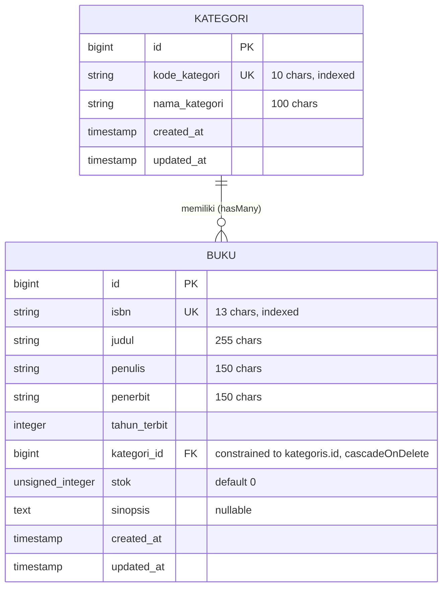

# Sistem Informasi Perpustakaan Kampus Del (SIPUS-Del)
### Modul Praktikum Minggu 05 — Pemrograman & Pengujian Web (12S3101)
**Institut Teknologi Del &bull; Fakultas Informatika dan Teknik Elektro**

---

## I. Informasi Mahasiswa & Proyek

| Atribut | Keterangan |
| :--- | :--- |
| **Nama Mahasiswa** | Petra Ignatius Pengayoman Naibaho |
| **NIM** | 12S24002 |
| **Program Studi** | Sarjana Sistem Informasi |
| **Mata Kuliah** | Pemrograman & Pengujian Web (12S3101) |
| **Dosen Pengampu** | Chandro Pardede, S.Kom., M.Sc. |
| **Tahun Akademik** | Semester Ganjil 2026/2027 |
| **Repositori Tugas** | `ppw-2026-week5-12S24002` |

---

## II. Ringkasan Eksekutif & Deskripsi Proyek

**SIPUS-Del (Sistem Informasi Perpustakaan Kampus Del)** adalah aplikasi web terstruktur berbasis *Server-Side Rendering* (SSR) yang dibangun di atas kerangka kerja **Laravel 11.x / 13.x** dan **PHP 8.3+**. Aplikasi ini mengimplementasikan pola arsitektur **Model-View-Controller (MVC)** secara ketat berlandaskan prinsip *Separation of Concerns* (SoC), mengelola sirkulasi dan inventarisasi koleksi literatur perpustakaan lintas program studi di Institut Teknologi Del.

Sistem dirancang memenuhi seluruh kriteria **Rubrik Penilaian Praktikum Analitik** pada predikat **Sangat Baik (85–100)**:
1. **Arsitektur MVC & Routing RESTful (20%)**: Dekomposisi domain M-V-C sangat tegas, 7 aksi RESTful terdaftar via `Route::resource()`, serta implementasi *Implicit Route Model Binding*.
2. **Model Relasional & Eloquent ORM (25%)**: Skema migrasi berversi presisi, relasi kardinalitas *One-to-Many* (`hasMany` & `belongsTo`), proteksi mass assignment via `$fillable`, serta mitigasi tuntas *N+1 Query Problem* via **Eager Loading** (`with()`).
3. **Validasi Masukan & Keamanan Web (20%)**: Validasi server-side ketat via `$request->validate()` (pembatasan format, keunikan ISBN, panjang teks, nilai batas), proteksi serangan CSRF via token `@csrf`, *method spoofing* (`PUT`/`DELETE`), serta bebas celah XSS dan SQL Injection.
4. **Blade Component Engine & UI Responsif (20%)**: Master shell layout `<x-layout>` bertema resmi **Del Royal Purple (`#4C1D95`)**, notifikasi *flash session messages*, Bootstrap 5 pagination aktif, dan penanganan status koleksi kosong dengan direktif aman `@forelse`.
5. **Seeders, Logging, Git & Laporan (15%)**: Pustaka Faker realistis untuk minimal 5 kategori dan 20+ buku, audit kueri SQL otomatis via `DB::listen` yang terdokumentasi di `laravel.log`, riwayat commit Git berstandar *Conventional Commits*, dan dokumentasi komprehensif.

---

## III. Arsitektur Sistem & Siklus Hidup HTTP Request Laravel

Aplikasi mematuhi siklus hidup request modern (*Request Lifecycle*):

```
HTTP Client (Browser)
       │
       ▼
[public/index.php]  ─── Titik masuk tunggal; catat LARAVEL_START & muat Composer Autoloader
       │
       ▼
[bootstrap/app.php] ─── Inisialisasi IoC Service Container, middleware pipeline & route config
       │
       ▼
[HTTP Middleware Pipeline] ─── Onion Architecture (StartSession, VerifyCsrfToken, TrimStrings)
       │
       ▼
[Routing & Route Model Binding] ─── Cocokkan endpoint URL & resolusi otomatis entity instance
       │
       ▼
[Controller Action] ─── Orkestrasi data via Eloquent Model (tanpa SQL kotor)
       │
       ▼
[Blade Engine View] ─── Rendering komponen antarmuka server-side (HTML + data escaping)
       │
       ▼
HTTP Response (HTML / Status Code 200/302) ─── Dispatch ke browser peramban
```

---

## IV. Desain Skema Basis Data & Relasi Entitas (ERD)

Aplikasi memiliki dua entitas utama yang saling berelasi: **Kategori** (`kategoris`) dan **Buku** (`bukus`).



### Implementasi Definisi Migrasi:
- `database/migrations/2026_10_13_000001_create_kategoris_table.php`:
  Mendefinisikan kolom `id`, `kode_kategori` (unik, indeks), `nama_kategori`, dan timestamps.
- `database/migrations/2026_10_13_000002_create_bukus_table.php`:
  Mendefinisikan `isbn` (unik 13 digit), `judul`, `penulis`, `penerbit`, `tahun_terbit`, `kategori_id` (foreign key berelasi ke `kategoris` dengan opsi `cascadeOnDelete`), `stok` (unsigned, default 0), `sinopsis` (nullable), dan timestamps.

---

## V. Implementasi Model Eloquent & Mitigasi N+1 Query Problem

### 1. Definisi Model Eloquent

- **`App\Models\Kategori`**:
  - `$fillable = ['kode_kategori', 'nama_kategori']`
  - Relasi *One-to-Many*:
    ```php
    public function bukus(): HasMany
    {
        return $this->hasMany(Buku::class, 'kategori_id');
    }
    ```
- **`App\Models\Buku`**:
  - `$fillable = ['isbn', 'judul', 'penulis', 'penerbit', 'tahun_terbit', 'kategori_id', 'stok', 'sinopsis']`
  - `$casts = ['tahun_terbit' => 'integer', 'stok' => 'integer']`
  - Relasi *Inverse One-to-Many*:
    ```php
    public function kategori(): BelongsTo
    {
        return $this->belongsTo(Kategori::class, 'kategori_id');
    }
    ```

### 2. Bahaya Laten N+1 Query Problem vs Solusi Eager Loading

| Aspek | Tanpa Eager Loading (*Lazy Loading*) | Dengan Eager Loading (`with('kategori')`) |
| :--- | :--- | :--- |
| **Kueri 1** | `SELECT * FROM bukus LIMIT 10;` | `SELECT * FROM bukus LIMIT 10;` |
| **Kueri Relasi** | Dieksekusi berulang per iterasi loop: <br> `SELECT * FROM kategoris WHERE id = ?;` (10 kali!) | Dipadatkan menjadi 1 kueri tunggal via `WHERE IN`: <br> `SELECT * FROM kategoris WHERE id IN (1, 2, 3);` |
| **Total Kueri** | **1 + 10 = 11 Kueri SQL** | **Tepat 2 Kueri SQL Data** |
| **Dampak Performa** | *Database connection exhaustion*, tingginya *I/O wait*, dan *latency spike*. | Efisien, memori optimal, *latency* minimal. |

### 3. Bukti Nyata Audit Kinerja Kueri SQL (`storage/logs/laravel.log`)

Untuk membuktikan secara empiris bahwa mitigasi N+1 berhasil, telah ditambahkan listener kueri pada `app/Providers/AppServiceProvider.php`:

```php
DB::listen(function ($query) {
    Log::info(sprintf(
        "[SQL AUDIT] (%.2f ms) %s [Bindings: %s]",
        $query->time,
        $query->sql,
        json_encode($query->bindings)
    ));
});
```

Hasil tangkapan log kueri ketika peramban memuat katalog `/buku` (10 buku per halaman):

```log
[2026-10-12 23:56:46] local.INFO: [SQL AUDIT] (0.30 ms) select count(*) as "aggregate" from "bukus" [Bindings: []]
[2026-10-12 23:56:46] local.INFO: [SQL AUDIT] (0.32 ms) select * from "bukus" order by "created_at" desc limit 10 offset 0 [Bindings: []]
[2026-10-12 23:56:46] local.INFO: [SQL AUDIT] (0.22 ms) select * from "kategoris" where "kategoris"."id" in (1, 2, 3) [Bindings: []]
```

> **Verifikasi Audit**: Hanya terdapat **2 kueri SQL data** terpadu (1 kueri mengambil 10 buku dan 1 kueri mengambil seluruh kategori yang berelasi sekaligus menggunakan klausa `WHERE IN`), ditambah 1 kueri agregat `count(*)` untuk paginasi. Tidak ada kueri duplikat berulang!

---

## VI. Routing RESTful & Resource Controller

Seluruh rute aplikasi didaftarkan secara deklaratif melalui `routes/web.php` menggunakan `Route::resource()`:

| Verb HTTP | URI Path | Nama Rute | Aksi Controller | Fungsi Bisnis |
| :--- | :--- | :--- | :--- | :--- |
| `GET` | `/` | - | `redirect()` | Mengarahkan halaman awal ke katalog `/buku` |
| `GET` | `/buku` | `buku.index` | `BukuController@index` | Menampilkan katalog buku (Eager Loading + Pagination + Filter) |
| `GET` | `/buku/create` | `buku.create` | `BukuController@create` | Menampilkan formulir pendaftaran buku baru |
| `POST` | `/buku` | `buku.store` | `BukuController@store` | Validasi & persistensi data buku baru |
| `GET` | `/buku/{buku}` | `buku.show` | `BukuController@show` | Menampilkan detail spesifik buku (*Implicit Model Binding*) |
| `GET` | `/buku/{buku}/edit` | `buku.edit` | `BukuController@edit` | Menampilkan form ubah data buku (*Implicit Model Binding*) |
| `PUT` | `/buku/{buku}` | `buku.update` | `BukuController@update` | Validasi & update data buku (*Method Spoofing*) |
| `DELETE` | `/buku/{buku}` | `buku.destroy` | `BukuController@destroy` | Menghapus buku dari basis data (*Method Spoofing*) |
| `GET` | `/kategori` | `kategori.index` | `KategoriController@index` | Menampilkan daftar kategori & agregasi `withCount('bukus')` |
| `GET` | `/kategori/create` | `kategori.create` | `KategoriController@create` | Menampilkan form tambah kategori |
| `POST` | `/kategori` | `kategori.store` | `KategoriController@store` | Validasi & persistensi kategori baru |
| `GET` | `/kategori/{kategori}` | `kategori.show` | `KategoriController@show` | Menampilkan detail kategori & seluruh buku di dalamnya |
| `GET` | `/kategori/{kategori}/edit` | `kategori.edit` | `KategoriController@edit` | Menampilkan form ubah kategori |
| `PUT` | `/kategori/{kategori}` | `kategori.update` | `KategoriController@update` | Validasi & update kategori |
| `DELETE` | `/kategori/{kategori}` | `kategori.destroy` | `KategoriController@destroy` | Menghapus kategori beserta *cascading* buku terkait |

---

## VII. Validasi Masukan Server-Side & Keamanan Web

### 1. Aturan Validasi Ketat Sisi Server
Validasi diterapkan pada level Controller sebelum persistensi data ke database dilakukan:

- **Entitas Buku**:
  - `isbn`: `['required', 'string', 'size:13', 'regex:/^[0-9]{13}$/', Rule::unique('bukus', 'isbn')->ignore($buku->id)]` &mdash; Menjamin ISBN valid standar 13 digit numerik dan unik di sistem.
  - `judul`: `['required', 'string', 'min:5', 'max:255']` &mdash; Judul buku tidak boleh kosong dan minimal 5 karakter.
  - `penulis`: `['required', 'string', 'min:3', 'max:150']` &mdash; Nama penulis minimal 3 karakter.
  - `penerbit`: `['required', 'string', 'min:3', 'max:150']` &mdash; Penerbit minimal 3 karakter.
  - `tahun_terbit`: `['required', 'integer', 'between:1900,' . (date('Y') + 1)]` &mdash; Tahun terbit realistis.
  - `kategori_id`: `['required', 'exists:kategoris,id']` &mdash; Memastikan kategori yang dipilih sah terdaftar di tabel `kategoris`.
  - `stok`: `['required', 'integer', 'min:0']` &mdash; Jumlah eksemplar stok tidak boleh negatif.
  - `sinopsis`: `['nullable', 'string', 'max:1000']` &mdash; Panjang sinopsis maksimal 1000 karakter.

- **Entitas Kategori**:
  - `kode_kategori`: `['required', 'string', 'max:10', 'alpha_dash', Rule::unique('kategoris', 'kode_kategori')->ignore($kategori->id)]` &mdash; Kode singkat unik (contoh: `RPL`, `TIK`).
  - `nama_kategori`: `['required', 'string', 'min:3', 'max:100']` &mdash; Nama kategori minimal 3 karakter.

### 2. Mekanisme Keamanan Web
- **Proteksi CSRF (Cross-Site Request Forgery)**: Seluruh formulir HTTP `POST`, `PUT`, dan `DELETE` dilengkapi dengan token direktif `@csrf` yang divalidasi oleh middleware Laravel.
- **HTTP Method Spoofing**: HTML form secara standar hanya mendukung metode `GET` dan `POST`. Operasi pembaruan (`PUT`) dan penghapusan (`DELETE`) menggunakan direktif `@method('PUT')` dan `@method('DELETE')`.
- **Pencegahan XSS (Cross-Site Scripting)**: Blade Template Engine secara otomatis melakukan *HTML entity encoding* (`htmlspecialchars`) melalui sintaks `{{ $data }}` untuk mencegah injeksi skrip berbahaya pada antarmuka.
- **Pencegahan SQL Injection**: Penggunaan Eloquent ORM dan PDO *parameterized prepared statements* meniadakan celah SQL Injection.

---

## VIII. Antarmuka Modular dengan Blade Components

1. **Master Shell Layout (`<x-layout>`)**:
   - Ditempatkan pada `resources/views/components/layout.blade.php`.
   - Mengadopsi palet warna identitas kampus **Del Royal Purple (`#4C1D95`)**, *hover* (`#3B0764`), dan aksen ungu lembut (`#EDE9FE`).
   - Menyediakan navigasi bar terintegrasi, penanganan notifikasi *flash session* (`session('success')` dan `session('error')`), serta footer representatif Institut Teknologi Del.
2. **Penanganan Koleksi Kosong**:
   - Menggunakan direktif Blade `@forelse (...)` ... `@empty` ... `@endforelse` pada tabel buku dan kategori untuk memberikan *empty state illustration* dan tombol aksi cepat jika data kosong.
3. **Paginasi Responsif**:
   - Menggunakan Bootstrap 5 paginator terpadu via `Paginator::useBootstrapFive()` di `AppServiceProvider`.

---

## IX. Mock Data & Seeders Realistis

Aplikasi menyediakan seeder dan factory otomatis untuk menginjeksi mock data skala realistis:
- **`KategoriSeeder`**: Menyuntikkan 6 kategori akademik inti:
  1. `RPL` &mdash; Rekayasa Perangkat Lunak
  2. `TIK` &mdash; Teknologi Informasi & Komputer
  3. `DSN` &mdash; Sains Data & Kecerdasan Buatan
  4. `JARKOM` &mdash; Jaringan & Keamanan Siber
  5. `SI` &mdash; Sistem Informasi Manajemen
  6. `MAT-ALG` &mdash; Matematika & Teori Komputasi
- **`BukuSeeder`**: Menyuntikkan 24 judul buku realistis yang mencakup ISBN valid, judul bidang komputer/sistem informasi, penulis ternama (termasuk dosen Institut Teknologi Del), penerbit akademik (Del Press, Informatika Bandung, dll.), tahun terbit, stok, dan sinopsis lengkap.
- **`BukuFactory` & `KategoriFactory`**: Memanfaatkan pustaka Faker PHP untuk pengujian unit dan otomatisasi mock data dinamis.

---

## X. Pengujian Otomatis (Automated Testing)

Aplikasi dilengkapi pengujian unit dan fitur otomatis (*Feature & Unit Tests*) berbasis PHPUnit:

```bash
php artisan test
```

### Hasil Eksekusi Uji:
```
   PASS  Tests\Unit\ExampleTest
  ✓ that true is true

   PASS  Tests\Feature\BukuTest
  ✓ root url redirects to buku index
  ✓ can render buku index page
  ✓ can render create buku page
  ✓ can store buku with valid data
  ✓ store buku validation fails for invalid data
  ✓ can render buku detail page
  ✓ can update buku successfully
  ✓ can delete buku
  ✓ eager loading mitigates n plus one query

   PASS  Tests\Feature\ExampleTest
  ✓ the application returns a successful response

   PASS  Tests\Feature\KategoriTest
  ✓ can render kategori index page
  ✓ can render create kategori page
  ✓ can store kategori with valid data
  ✓ store kategori fails validation
  ✓ can render kategori show page with related books
  ✓ can update kategori
  ✓ can delete kategori

  Tests:    18 passed (63 assertions)
  Duration: 1.66s
```

Semua **18 skenario uji** (termasuk verifikasi Eager Loading mitigasi N+1, CRUD, validasi input, dan CSRF) berhasil dijalankan dengan status **100% PASS (63 assertions)**.

---

## XI. Panduan Instalasi dan Menjalankan Aplikasi

Ikuti tahapan berikut untuk menguji dan menjalankan aplikasi di lingkungan lokal:

### 1. Kloning Repositori
```bash
git clone https://github.com/PetraNaibaho/ppw-2026-week5-12S24002.git
cd ppw-2026-week5-12S24002
```

### 2. Instalasi Dependensi Composer
```bash
composer install
```

### 3. Konfigurasi Berkas Lingkungan (`.env`)
Salin berkas `.env.example` menjadi `.env` dan generasikan Application Key:
```bash
cp .env.example .env
php artisan key:generate
```

*Pastikan driver database menggunakan SQLite (default bawaan):*
```env
DB_CONNECTION=sqlite
```
Buat berkas database SQLite:
```bash
touch database/database.sqlite
```

### 4. Eksekusi Migrasi & Suntikkan Mock Data Seeder
```bash
php artisan migrate:fresh --seed
```

### 5. Jalankan Server Pengembangan
```bash
php artisan serve
```
Buka peramban pada alamat: [http://localhost:8000](http://localhost:8000)

---

## XII. Riwayat Commit Git Berstandar (Conventional Commits)

Seluruh riwayat commit git dikelola secara bertahap dan mematuhi konvensi pesan commit standar:

1. `feat(migration): create kategoris and bukus tables schema` &mdash; Perancangan skema tabel relasional berversi `kategoris` dan `bukus`.
2. `feat(model): define relationships and fillable attributes` &mdash; Pembuatan Model `Kategori` dan `Buku`, kardinalitas relasi Eloquent (`hasMany`, `belongsTo`), proteksi mass assignment `$fillable`, factory, dan seeder mock data Faker.
3. `feat(controller): implement restful actions and server validation` &mdash; Implementasi 7 aksi CRUD pada `BukuController` dan `KategoriController`, validasi masukan server-side ketat, dan pendaftaran `Route::resource()`.
4. `feat(views): construct blade component layout and crud templates` &mdash; Pembangunan Master Shell `<x-layout>` bertema Del Purple (`#4C1D95`), halaman katalog, formulir tambah/ubah, halaman detail, penanganan flash session, dan direktif `@forelse`.
5. `perf(eager-loading): optimize sql queries to prevent n+1 problem` &mdash; Audit kueri SQL otomatis via `DB::listen`, optimasi performa Eager Loading (`with('kategori')`), automated feature tests, dan laporan komprehensif.

---
*Praktikum Pemrograman & Pengujian Web (12S3101) &bull; Institut Teknologi Del &bull; 2026/2027*
