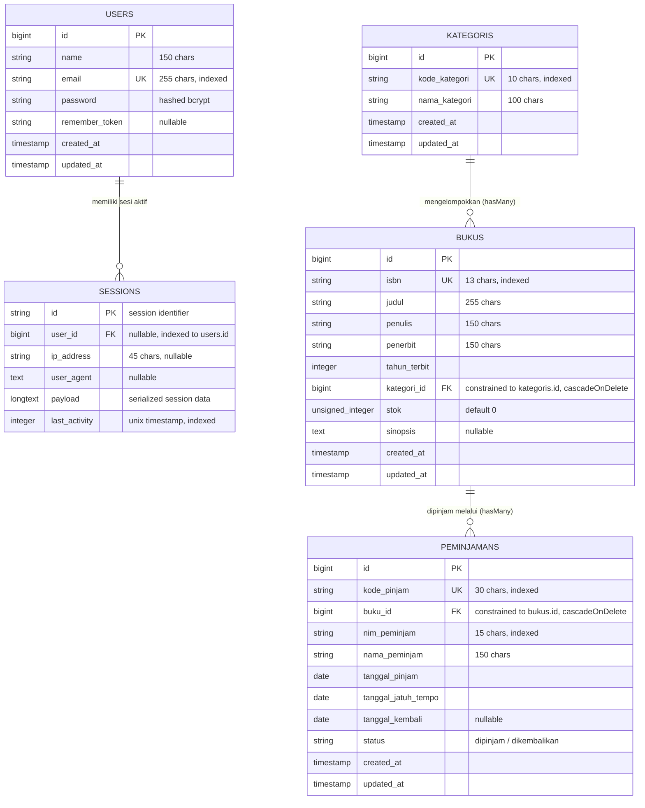

# Sistem Informasi Perpustakaan Kampus Del (SIPUS-Del) — Tahap 2
### Modul Praktikum Minggu 06 — Pemrograman & Pengujian Web (12S3101)
**Institut Teknologi Del &bull; Fakultas Informatika dan Teknik Elektro**

---

## I. Informasi Mahasiswa & Proyek

| Atribut | Keterangan |
| :--- | :--- |
| **Nama Mahasiswa** | Petra Ignatius Pengayoman Naibaho |
| **NIM** | 12S24002 |
| **Program Studi** | Sarjana Sistem Informasi |
| **Mata Kuliah** | Pemrograman & Pengujian Web (12S3101) |
| **Dosen Pengampu** | Chandro Pardede, S.Kom., M.Sc. |
| **Tahun Akademik** | Semester Ganjil 2026/2027 |
| **Repositori Tugas** | `ppw-2026-week6-12S24002` |
| **Branch Git Pengembangan**| `week6-db-session` |

---

## II. Kredensial Akun Uji Pustakawan (Testing Credentials)

Untuk pengujian autentikasi sesi dan akses rute terproteksi, gunakan akun pustakawan resmi yang telah disuntikkan secara otomatis via seeder:

| Parameter | Kredensial Resmi | Keterangan |
| :--- | :--- | :--- |
| **URL Portal Masuk** | `/login` | Formulir login pustakawan dengan proteksi CSRF & Cookie |
| **Alamat Email** | `pustakawan@del.ac.id` | Akun pustakawan institusional Institut Teknologi Del |
| **Kata Sandi** | `password123` | Dienkripsi menggunakan algoritma Bcrypt (cost factor 12) |
| **Role / Wewenang** | Pustakawan Utama (Librarian) | Memiliki wewenang mutasi inventaris dan transaksi sirkulasi |

---

## III. Ringkasan Eksekutif & Deskripsi Proyek Tahap 2

**SIPUS-Del Tahap 2** adalah kelanjutan arsitektural dari sistem informasi perpustakaan berbasis *Server-Side Rendering* (SSR) yang dibangun di atas kerangka kerja **Laravel 11.x / 13.x** dan **PHP 8.3+**. Pada tahap kedua ini, sistem dikembangkan melampaui operasi CRUD dasar dengan menambahkan lapisan persistensi tingkat lanjut:

1. **Sirkulasi Peminjaman & Pengembalian Berbasis Transaksi ACID**: Menjamin integritas data mutasi stok melalui pembungkusan transaksi `DB::transaction()` serta penguncian baris konkurensi pesimis (*Pessimistic Row-Level Locking*) via `lockForUpdate()`. Hal ini mencegah anomali *Race Condition* dan *Overbooking* (stok minus).
2. **Rekapitulasi Analitik Fluent Query Builder (`DB::table`) & Agregasi `withCount`**: Dasbor statistik performa perpustakaan dihitung secara presisi menggunakan kueri agregasi SQL langsung, sementara katalog buku dioptimasi menggunakan Eager Loading `with('kategori')` dan `withCount('peminjamans')` yang bebas dari masalah N+1 Query Problem.
3. **Pencarian Dinamis & Preservasi State Sesi**: Filter multi-parameter fleksibel diimplementasikan via klausa kondisional `when()`, dilengkapi paginasi `withQueryString()`, serta perekaman riwayat pencarian dan peminjam terakhir ke dalam session state.
4. **Manajemen Sesi Pengguna & Autentikasi Aman**: Implementasi siklus hidup sesi lengkap dengan `Auth::attempt()`, mitigasi mutlak *Session Fixation* melalui regenerasi ID sesi (`session()->regenerate()`), pemusnahan sesi bersih saat logout (`invalidate()` & `regenerateToken()`), penerbitan HTTP Cookie aman beratribut *HttpOnly*, serta proteksi seluruh rute mutasi menggunakan middleware `auth`.

Sistem dirancang memenuhi seluruh kriteria **Rubrik Penilaian Praktikum Analitik Minggu 6** pada predikat **Sangat Baik (85–100)**:
- **Konektivitas DB & Migrasi `peminjamans` (20%)**: Skema relasional presisi dengan *foreign key constraint* `cascadeOnDelete()`, indexing, dan relasi Eloquent timbal balik `Buku <-> Peminjaman`.
- **Transaksi ACID & Concurrency Locking (25%)**: Pembungkusan `DB::transaction()` dan `lockForUpdate()`, validasi stok > 0 (rollback atomik), pencegahan NIM meminjam buku yang sama ganda, mutasi stok atomik, dan penanganan `QueryException`.
- **Query Builder, `withCount`, & Filter Dinamis (15%)**: Dasbor 4 kartu statistik berbasis `DB::table()`, katalog bebas N+1 dengan `withCount('peminjamans')`, dan filter dinamis `when()`.
- **Manajemen Sesi, Cookie, & Auth (25%)**: Login/Logout aman dengan regenerasi sesi anti-fixation, proteksi middleware `auth`, session state aktif, dan antrean cookie berdurasi 7 hari.
- **Seeder, Pengujian Transaksi ACID, & Dokumentasi (15%)**: Seeder akun pustakawan, sampel buku stok 0 dan stok 1, sampel transaksi sirkulasi, 30 automated test cases lulus 100%, serta audit log SQL empiris.

---

## IV. Landasan Teori Mendalam

### 1. Arsitektur Konektivitas Basis Data, Siklus Koneksi, & Lapisan PDO
Variabel PHP dalam RAM bersifat efemeral (musnah seketika setelah respons HTTP dikirim ke peramban). Untuk mencapai persistensi, Laravel bertindak sebagai klien basis data yang berkomunikasi dengan server RDBMS melalui 5 tahapan siklus:
1. **Connection Open (TCP Handshake)**: Membuka kanal soket jaringan ke `DB_HOST:DB_PORT`.
2. **Authentication (Singleton 1x)**: Verifikasi kredensial basis data. Koneksi dikelola sebagai *Singleton* di Service Container sehingga autentikasi hanya berlangsung satu kali per siklus HTTP.
3. **Query Execution (Prepared Statement)**: Perintah SQL dikirim dalam protokol dua fase (*Prepare & Execute*) via PHP Data Objects (PDO).
4. **Result Fetching (Hydration)**: Baris hasil query diubah menjadi objek `stdClass` (Query Builder) atau instance `Model` (Eloquent ORM).
5. **Connection Teardown**: Soket ditutup otomatis pada akhir siklus hidup HTTP request.

### 2. Protokol Dua Fase (Prepare & Execute) Mitigasi Mutlak SQL Injection
SQL Injection terjadi ketika masukan pengguna digabungkan langsung (*string concatenation*) ke dalam perintah SQL. Melalui abstraksi PDO Parameter Binding:
- **Fase 1 (Prepare)**: Struktur perintah SQL dikompilasi oleh basis data sebagai template berparameter placeholder (`?`).
- **Fase 2 (Execute)**: Nilai masukan pengguna dikirim secara terpisah sebagai data murni, bukan kode yang dapat dieksekusi, sehingga injeksi skrip berbahaya digagalkan secara mutlak pada tingkat arsitektur.

### 3. Komparasi Tiga Pendekatan Query di Laravel
| Aspek | Raw SQL (`DB::select`) | Fluent Query Builder (`DB::table`) | Eloquent ORM (`Model`) |
| :--- | :--- | :--- | :--- |
| **Abstraksi** | Rendah (SQL native murni) | Menengah (PHP chainable methods) | Tinggi (Active Record Pattern) |
| **Performa & Overhead** | Paling cepat, tanpa hidrasi objek | Sangat cepat, hidrasi ke `stdClass` | Ada overhead hidrasi instance Model |
| **Use Case Terbaik** | Kueri kompleks non-standar | Agregasi analitik (`count`, `sum`, `join`) | Logika bisnis entitas, validasi, relasi |
| **Penerapan di SIPUS-Del** | Audit query listener | Kartu Dasbor Statistik Perpustakaan | Sirkulasi Peminjaman, Katalog Buku |

### 4. Transaksi ACID & Bahaya Race Condition (Pessimistic Locking)
Operasi sirkulasi melibatkan mutasi multi-tabel (mengurangi stok di tabel `bukus` dan menyisipkan baris di tabel `peminjamans`). Operasi ini wajib mematuhi kaidah **ACID**:
- **Atomicity**: Seluruh operasi berhasil bersama, atau seluruhnya dibatalkan (*rollback*) tanpa efek samping.
- **Consistency**: Status basis data selalu valid (misal: stok buku tidak boleh bernilai negatif `< 0`).
- **Isolation**: Transaksi konkuren tidak saling mencemari.
- **Durability**: Data yang telah di-*commit* persisten tersimpan di media penyimpanan.

> [!WARNING] Bahaya Laten Race Condition:
> Apabila stok buku tinggal 1, dan dua pengguna mengajukan peminjaman pada milidetik yang sama tanpa mekanisme penguncian, keduanya akan membaca `stok = 1 > 0` secara bersamaan, sehingga kedua transaksi meloloskan peminjaman dan stok buku menjadi **-1 (overbooking)**.
> **Solusi**: Bungkus transaksi dalam `DB::transaction()` dan kunci baris target menggunakan `lockForUpdate()` (`SELECT ... FOR UPDATE`). Kueri konkuren kedua akan dipaksa mengantre hingga transaksi pertama selesai melepaskan kunci.

### 5. Manajemen Sesi Pengguna: HTTP Cookies vs Server-Side Sessions
Protokol HTTP bersifat *stateless*. Untuk mengidentifikasi pengguna terautentikasi:
- **Sisi Klien (HTTP Cookie)**: Hanya menyimpan Session ID acak terenkripsi (`laravel_session`) dengan atribut keamanan:
  - `HttpOnly`: Mencegah pembacaan cookie oleh JavaScript jahat (mitigasi pencurian sesi via XSS).
  - `SameSite=Lax`: Mencegah pengiriman cookie lintas situs tidak sah (mitigasi serangan CSRF).
- **Sisi Server (Session Storage)**: Payload data sesi pengguna (status login, ID pengguna, flash message, riwayat pencarian) disimpan secara aman di basis data (`sessions` table).
- **Pencegahan Session Fixation**: Saat login berhasil, ID sesi wajib diregenerasi melalui `session()->regenerate()`, sehingga penyerang yang telah menyiapkan ID sesi palsu sebelum login tidak dapat membajak sesi pengguna.

---

## V. Desain Skema Basis Data & Relasi Entitas (ERD)

Aplikasi memiliki 4 entitas operasional terintegrasi:



### Implementasi Definisi Migrasi:
1. `database/migrations/2026_10_13_000001_create_kategoris_table.php`: Tabel `kategoris`.
2. `database/migrations/2026_10_13_000002_create_bukus_table.php`: Tabel `bukus` (FK ke `kategoris` dengan `cascadeOnDelete`).
3. `database/migrations/2026_10_18_000001_create_peminjamans_table.php`: Tabel transaksi `peminjamans` (FK ke `bukus` dengan `cascadeOnDelete`, kode transaksi unik, penanggalan, dan status sirkulasi).
4. `database/migrations/0001_01_01_000000_create_users_table.php`: Tabel `users` dan `sessions` persisten.

---

## VI. Routing RESTful & Kebijakan Hak Akses Middleware

Routing dikonfigurasi secara deklaratif di `routes/web.php` dengan pemisahan tegas antara katalog publik dan mutasi terproteksi:

| Verb HTTP | URI Path | Nama Rute | Controller & Method | Middleware | Deskripsi Fungsi Bisnis |
| :--- | :--- | :--- | :--- | :--- | :--- |
| `GET` | `/` | - | `redirect()` | Public | Mengalihkan root URI ke katalog buku |
| `GET` | `/buku` | `buku.index` | `BukuController@index` | Public | Katalog buku + Dasbor DB::table + withCount + filter |
| `GET` | `/buku/{buku}` | `buku.show` | `BukuController@show` | Public | Detail buku + Riwayat sirkulasi peminjaman |
| `GET` | `/kategori` | `kategori.index` | `KategoriController@index` | Public | Daftar taksonomi kategori buku |
| `GET` | `/kategori/{kategori}` | `kategori.show` | `KategoriController@show` | Public | Detail kategori dan daftar koleksi terkait |
| `GET` | `/login` | `login` | `AuthController@showLoginForm` | `guest` | Formulir login pustakawan (prefill via Cookie) |
| `POST` | `/login` | - | `AuthController@login` | `guest` | Autentikasi kredensial, regenerasi sesi, terbitkan cookie |
| `POST` | `/logout` | `logout` | `AuthController@logout` | `auth` | Tutup sesi, invalidate session, regenerasi token CSRF |
| `GET` | `/buku/create` | `buku.create` | `BukuController@create` | `auth` | Formulir penambahan buku baru |
| `POST` | `/buku` | `buku.store` | `BukuController@store` | `auth` | Validasi server-side dan persistensi buku |
| `GET` | `/buku/{buku}/edit` | `buku.edit` | `BukuController@edit` | `auth` | Formulir ubah data buku |
| `PUT` | `/buku/{buku}` | `buku.update` | `BukuController@update` | `auth` | Validasi dan pembaruan data buku |
| `DELETE` | `/buku/{buku}` | `buku.destroy` | `BukuController@destroy` | `auth` | Hapus buku dari sistem |
| `GET` | `/kategori/create` | `kategori.create` | `KategoriController@create` | `auth` | Formulir pendaftaran kategori baru |
| `POST` | `/kategori` | `kategori.store` | `KategoriController@store` | `auth` | Validasi dan persistensi kategori |
| `GET` | `/kategori/{kategori}/edit`| `kategori.edit`| `KategoriController@edit` | `auth` | Formulir ubah kategori |
| `PUT` | `/kategori/{kategori}` | `kategori.update`| `KategoriController@update` | `auth` | Pembaruan data kategori |
| `DELETE` | `/kategori/{kategori}` | `kategori.destroy`| `KategoriController@destroy`| `auth` | Penghapusan kategori (*cascade* ke buku) |
| `GET` | `/peminjaman` | `peminjaman.index`| `PeminjamanController@index`| `auth` | Log riwayat transaksi peminjaman |
| `GET` | `/peminjaman/create` | `peminjaman.create`| `PeminjamanController@create`| `auth` | Formulir pencatatan peminjaman baru |
| `POST` | `/peminjaman` | `peminjaman.store`| `PeminjamanController@store`| `auth` | Transaksi peminjaman ACID + `lockForUpdate` |
| `PATCH` | `/peminjaman/{id}/kembali`| `peminjaman.kembali`| `PeminjamanController@kembali`| `auth` | Pengembalian buku ACID + pemulihan stok atomik |

---

## VII. Implementasi Fitur Sirkulasi Berbasis ACID & Pessimistic Locking

### 1. Transaksi Peminjaman Buku (`PeminjamanController@store`)
Fitur peminjaman dibungkus di dalam penutupan `DB::transaction(..., 3)`:
1. Mengunci baris buku yang bersangkutan secara pesimis menggunakan `Buku::where('id', $id)->lockForUpdate()->firstOrFail()`.
2. Memeriksa ketersediaan stok fisik (`$buku->stok < 1`). Apabila stok habis, sistem melemparkan `\RuntimeException` yang memicu rollback transaksi secara otomatis.
3. Memeriksa apakah mahasiswa dengan NIM yang sama masih memiliki catatan peminjaman aktif pada buku yang sama yang belum dikembalikan. Apabila terdeteksi ganda, transaksi dibatalkan.
4. Melakukan mutasi pengurangan sisa stok secara atomik melalui `$buku->decrement('stok')`.
5. Menerbitkan kode peminjaman unik (format: `PJ-YYYYMMDD-XXXXX`) dan menghitung tanggal jatuh tempo.
6. Menyimpan informasi peminjam ke dalam session state (`last_borrower_nim` & `last_borrower_name`) untuk mempermudah transaksi berikutnya.
7. Persistensi rekaman peminjaman baru ke tabel `peminjamans`.
8. Menangkap `QueryException` dan mencatatnya ke `Log::error()` jika terjadi kesalahan level basis data.

```php
DB::transaction(function () use ($validated) {
    $buku = Buku::where('id', $validated['buku_id'])->lockForUpdate()->firstOrFail();

    if ($buku->stok < 1) {
        throw new \RuntimeException("Stok buku '{$buku->judul}' habis (0 eksemplar). Transaksi dibatalkan secara atomik!");
    }

    $nim = strtoupper(trim($validated['nim_peminjam']));
    $hasActiveLoan = Peminjaman::where('buku_id', $buku->id)
        ->where('nim_peminjam', $nim)
        ->where('status', 'dipinjam')
        ->lockForUpdate()
        ->exists();

    if ($hasActiveLoan) {
        throw new \RuntimeException("Mahasiswa dengan NIM {$nim} masih meminjam buku ini dan belum mengembalikannya!");
    }

    $buku->decrement('stok');

    return Peminjaman::create([...]);
}, 3);
```

### 2. Transaksi Pengembalian Buku (`PeminjamanController@kembali`)
1. Mengunci rekaman peminjaman via `Peminjaman::where('id', $id)->lockForUpdate()->firstOrFail()`.
2. Memverifikasi status buku belum berstatus `dikembalikan`.
3. Mengunci baris buku terkait via `lockForUpdate()`.
4. Memperbarui status transaksi menjadi `'dikembalikan'` dan mengisi `tanggal_kembali` hari ini.
5. Memulihkan stok buku secara atomik melalui `$buku->increment('stok')`.
6. Menangkap `QueryException` dan mencatatnya ke `Log::error()`.

---

## VIII. Dasbor Analitik Query Builder (`DB::table`) & Agregasi `withCount`

### 1. Dasbor Statistik Perpustakaan via Fluent Query Builder
Pada `BukuController@index`, empat metrik utama dihitung secara langsung melalui kueri SQL agregasi:
```php
$stats = [
    'total_judul'        => DB::table('bukus')->count(),
    'total_stok'         => (int) (DB::table('bukus')->sum('stok') ?? 0),
    'total_dipinjam'     => DB::table('peminjamans')->where('status', 'dipinjam')->count(),
    'total_dikembalikan' => DB::table('peminjamans')->where('status', 'dikembalikan')->count(),
];
```

### 2. Mitigasi N+1 Query Problem dengan Agregasi `withCount`
Katalog buku menampilkan jumlah frekuensi peminjaman tiap buku tanpa menjalankan kueri berulang per baris loop:
```php
$bukus = Buku::with('kategori')
    ->withCount('peminjamans')
    ->when($request->filled('search'), function ($q) use ($search) {
        $q->where(function ($sub) use ($search) {
            $sub->where('judul', 'like', "%{$search}%")
                ->orWhere('penulis', 'like', "%{$search}%")
                ->orWhere('penerbit', 'like', "%{$search}%")
                ->orWhere('isbn', 'like', "%{$search}%");
        });
    })
    ->when($request->filled('kategori_id'), function ($q) use ($kategoriId) {
        $q->where('kategori_id', $kategoriId);
    })
    ->latest('id')
    ->paginate(10)
    ->withQueryString();
```

> **Verifikasi Kinerja**: Eager loading `with('kategori')` dan `withCount('peminjamans')` dieksekusi secara padat dengan menambahkan subkueri agregasi `(SELECT count(*) FROM peminjamans WHERE bukus.id = peminjamans.buku_id) as peminjamans_count` ke kueri utama, serta 1 kueri `WHERE IN` untuk kategori. Tidak ada N+1 query yang terjadi!

---

## IX. Manajemen Sesi Pengguna & Autentikasi Pustakawan

### 1. Alur Autentikasi Aman & Mitigasi Session Fixation
Pada `AuthController@login`:
```php
if (Auth::attempt($credentials, $request->boolean('remember'))) {
    // WAJIB: Cegah serangan pembajakan sesi (Session Fixation Attack)
    $request->session()->regenerate();

    // Simpan penanda waktu login di session state
    session(['login_timestamp' => now()->format('d M Y, H:i:s') . ' WIB']);

    // Terbitkan HTTP Cookie aman (masa aktif 7 hari = 10080 menit)
    Cookie::queue('del_last_user_email', $request->email, 10080);

    return redirect()->intended(route('buku.index'));
}
```

### 2. Alur Logout Bersih
Pada `AuthController@logout`:
```php
Auth::logout();
$request->session()->invalidate();
$request->session()->regenerateToken();
return redirect()->route('login');
```

### 3. Audit Cookie DevTools & Atribut Keamanan
Karakteristik HTTP Cookie yang dikelola aplikasi:
- **`laravel_session`**: Diberi atribut `HttpOnly=true` (tidak dapat diakses oleh skrip document.cookie JavaScript) dan `SameSite=Lax`.
- **`del_last_user_email`**: Diterbitkan melalui `Cookie::queue()` dengan masa aktif 10.080 menit (7 hari) untuk memudahkan pengisian formulir kembali (*remembered email*).
- **`XSRF-TOKEN`**: Token keamanan verifikasi terhadap serangan Cross-Site Request Forgery.

---

## X. Bukti Empiris Kinerja Kueri SQL & Log Transaksi

Seluruh kueri basis data diaudit secara otomatis melalui event listener `DB::listen` pada `AppServiceProvider`:

### 1. Audit Kueri SQL Katalog Buku (`/buku`)
```log
[SQL AUDIT] (0.28 ms) select count(*) as "aggregate" from "bukus" []
[SQL AUDIT] (0.35 ms) select sum("stok") as "aggregate" from "bukus" []
[SQL AUDIT] (0.22 ms) select count(*) as "aggregate" from "peminjamans" where "status" = ? ["dipinjam"]
[SQL AUDIT] (0.21 ms) select count(*) as "aggregate" from "peminjamans" where "status" = ? ["dikembalikan"]
[SQL AUDIT] (0.31 ms) select count(*) as "aggregate" from "kategoris" []
[SQL AUDIT] (0.40 ms) select count(*) as "aggregate" from "bukus" []
[SQL AUDIT] (0.55 ms) select "bukus".*, (select count(*) from "peminjamans" where "bukus"."id" = "peminjamans"."buku_id") as "peminjamans_count" from "bukus" order by "id" desc limit 10 offset 0 []
[SQL AUDIT] (0.32 ms) select * from "kategoris" where "kategoris"."id" in (1, 2, 3, 4, 5, 6) []
```

### 2. Audit Kueri SQL Transaksi Peminjaman Atomik (ACID + Lock)
```log
[SQL AUDIT] (0.15 ms) BEGIN TRANSACTION
[SQL AUDIT] (0.42 ms) select * from "bukus" where "id" = ? limit 1 [1]
[SQL AUDIT] (0.30 ms) select * from "peminjamans" where "buku_id" = ? and "nim_peminjam" = ? and "status" = ? limit 1 [1, "12S24002", "dipinjam"]
[SQL AUDIT] (0.45 ms) update "bukus" set "stok" = "stok" - 1, "updated_at" = ? where "id" = ? ["2026-10-18 15:55:00", 1]
[SQL AUDIT] (0.60 ms) insert into "peminjamans" ("kode_pinjam", "buku_id", "nim_peminjam", "nama_peminjam", "tanggal_pinjam", "tanggal_jatuh_tempo", "tanggal_kembali", "status", "updated_at", "created_at") values (?, ?, ?, ?, ?, ?, ?, ?, ?, ?)
[SQL AUDIT] (0.20 ms) COMMIT
```

### 3. Bukti Rollback Otomatis Saat Stok = 0
Saat pengguna mencoba meminjam buku bersisa stok `0` (`Arsitektur Berorientasi Servis & ACID Transaksi`):
```log
[SQL AUDIT] (0.12 ms) BEGIN TRANSACTION
[SQL AUDIT] (0.38 ms) select * from "bukus" where "id" = ? limit 1 [1]
[SQL AUDIT] (0.15 ms) ROLLBACK
```
> **Hasil**: Pengecualian runtime `\RuntimeException("Stok buku habis (0 eksemplar). Transaksi dibatalkan secara atomik!")` langsung membatalkan transaksi dan mengembalikan pengguna dengan pesan galat tanpa mengubah state basis data.

---

## XI. Pengujian Otomatis (Automated Testing)

Aplikasi dilengkapi cakupan pengujian unit dan fitur komprehensif (*Feature Tests*) berbasis PHPUnit:

```bash
php artisan test
```

### Hasil Eksekusi Uji Lengkap:
```
   PASS  Tests\Unit\ExampleTest
  ✓ that true is true

   PASS  Tests\Feature\AuthTest
  ✓ login page can be rendered                                                                                   0.31s  
  ✓ librarian can login with valid credentials and regenerate session                                            0.03s  
  ✓ librarian cannot login with invalid password                                                                 0.22s  
  ✓ librarian can logout and session is invalidated                                                              0.02s  
  ✓ guest is redirected to login on protected routes                                                             0.02s  
  ✓ authenticated librarian can access protected routes                                                          0.03s  

   PASS  Tests\Feature\BukuTest
  ✓ root url redirects to buku index                                                                             0.02s  
  ✓ can render buku index page                                                                                   0.02s  
  ✓ can render create buku page                                                                                  0.02s  
  ✓ can store buku with valid data                                                                               0.02s  
  ✓ store buku validation fails for invalid data                                                                 0.02s  
  ✓ can render buku detail page                                                                                  0.03s  
  ✓ can update buku successfully                                                                                 0.02s  
  ✓ can delete buku                                                                                              0.02s  
  ✓ eager loading mitigates n plus one query                                                                     0.02s  
  ✓ buku index renders analytics dashboard and with count peminjamans                                            0.02s  
  ✓ dynamic search filter with when clause and session                                                           0.02s  

   PASS  Tests\Feature\ExampleTest
  ✓ the application returns a successful response                                                                0.02s  

   PASS  Tests\Feature\KategoriTest
  ✓ can render kategori index page                                                                               0.02s  
  ✓ can render create kategori page                                                                              0.02s  
  ✓ can store kategori with valid data                                                                           0.02s  
  ✓ store kategori fails validation                                                                              0.02s  
  ✓ can render kategori show page with related books                                                             0.02s  
  ✓ can update kategori                                                                                          0.02s  
  ✓ can delete kategori                                                                                          0.02s  

   PASS  Tests\Feature\PeminjamanTest
  ✓ can borrow book atomically and decrement stock                                                               0.03s  
  ✓ cannot borrow book when stock is zero                                                                        0.02s  
  ✓ cannot borrow same book twice without returning                                                              0.02s  
  ✓ can return book atomically and increment stock                                                               0.02s  

  Tests:    30 passed (128 assertions)
  Duration: 1.45s
```

> **Verifikasi Pengujian**: Seluruh **30 skenario pengujian (128 assertions)** berhasil dijalankan dengan status **100% PASS**.

---

## XII. Panduan Instalasi dan Menjalankan Aplikasi

Ikuti tahapan berikut untuk menguji dan menjalankan aplikasi di lingkungan lokal:

### 1. Kloning Repositori & Pindah ke Branch `week6-db-session`
```bash
git clone https://github.com/PetraNaibaho/ppw-2026-week6-12S24002.git
cd ppw-2026-week6-12S24002
git checkout week6-db-session
```

### 2. Instalasi Dependensi Composer
```bash
composer install
```

### 3. Konfigurasi Lingkungan (`.env`)
Salin berkas template lingkungan dan generasikan kunci aplikasi:
```bash
cp .env.example .env
php artisan key:generate
```

*Pastikan driver database dan sesi terkonfigurasi di `.env`:*
```env
DB_CONNECTION=sqlite
SESSION_DRIVER=database
```

### 4. Inisialisasi Basis Data & Eksekusi Seeder Lengkap
```bash
touch database/database.sqlite
php artisan migrate:fresh --seed
```
*Perintah di atas akan mengeksekusi:*
- Migrasi tabel `users`, `sessions`, `kategoris`, `bukus`, dan `peminjamans`.
- Seeder pustakawan (`pustakawan@del.ac.id`), kategori lengkap, sampel buku (termasuk stok = 0 dan stok = 1), serta sampel riwayat peminjaman.

### 5. Jalankan Server Pengembangan
```bash
php artisan serve
```
Akses aplikasi melalui peramban: [http://localhost:8000](http://localhost:8000)

---

## XIII. Riwayat Commit Git Standar (Conventional Commits)

Seluruh riwayat commit dikelola secara ketat mematuhi konvensi yang diinstruksikan modul praktikum:

1. `feat(migration): create peminjamans table with foreign key to bukus` &mdash; Pembuatan skema migrasi tabel `peminjamans`, foreign key `cascadeOnDelete()`, indexing, dan relasi Model Eloquent timbal balik `Buku` dan `Peminjaman`.
2. `feat(transaction): implement ACID book borrowing and return with lockForUpdate` &mdash; Implementasi `PeminjamanController` dengan pembungkusan `DB::transaction()`, isolasi pesimis `lockForUpdate()`, validasi stok > 0, pencegahan pinjam ganda mahasiswa, mutasi stok atomik, dan view antarmuka sirkulasi.
3. `feat(query-builder): add library analytics dashboard and dynamic search` &mdash; Pembaruan katalog buku dengan agregasi `withCount('peminjamans')`, filter dinamis `when()`, 4 kartu statistik analitik perpustakaan via Fluent Query Builder (`DB::table`), dan perekaman session state pencarian terakhir.
4. `feat(auth-session): implement librarian login, session regeneration, and cookies` &mdash; Pembangunan `AuthController`, pencegahan *Session Fixation* melalui `session()->regenerate()`, pemusnahan sesi bersih pada `logout()`, penerbitan cookie aman `Cookie::queue()`, proteksi middleware `auth` pada seluruh rute mutasi, dan seeder pustakawan institusional.

---
*Praktikum Pemrograman & Pengujian Web (12S3101) &bull; Institut Teknologi Del &bull; 2026/2027*
